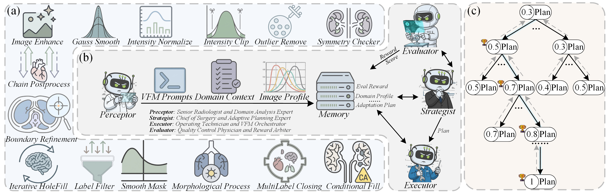
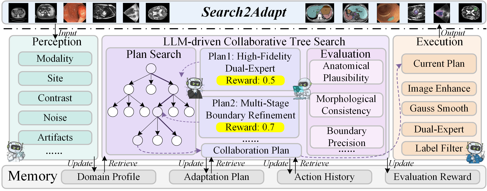

# Search2Adapt

**Multi-Agent Collaborative Tree Search for Source-Free Unsupervised Domain Adaptation**

Yulong Shi, Wenwen Zhang, Ziyi Li, Lin Qi — *ACM Multimedia 2026 (MM '26)*
[Paper DOI: 10.1145/3767308.3835160](https://doi.org/10.1145/3767308.3835160) · [ACM DL](https://dl.acm.org/doi/10.1145/3767308.3835160)


[](https://www.python.org/downloads/)

---

## Abstract

Source-Free Unsupervised Domain Adaptation (SFUDA) aims to mitigate domain shifts without accessing source data. Existing SFUDA approaches rely on **static, open-loop pipelines** with fixed adaptation procedures: they lack error correction, cannot adapt to the diverse characteristics of unseen target samples, and let early errors propagate unchecked.

**Search2Adapt** reformulates SFUDA as a **dynamic decision-making problem**. Four VLM-driven agents — *Perceptor*, *Strategist*, *Executor*, *Evaluator* — collaborate in a closed loop through a shared memory. At its core, **CoTS** (Collaborative Tree Search) explores a rich action space of vision foundation models (VFMs) and segmentation operators, scoring candidate plans with a **Collaborative Action-Value Function (CAVF)** that combines exploitation, √2 exploration, and a diversity bonus.

Because ground truth is unavailable in the SFUDA setting, the Evaluator estimates pseudo-label quality from programmatic geometric features and VLM reasoning. A visual evidence-grid evaluation path is also included, but the default search loop currently uses the text/geometric evaluator. A **CoT reflection** lets the Strategist calibrate the Evaluator, and a **dynamic prior memory** reuses successful trajectories across samples.

The discovered pseudo-labels are then distilled into a lightweight student model, compressing ~862M (SAM3) and ~371M (BiomedParse) parameters into a ~31M deployable network.



*Figure 1: Overall Search2Adapt framework, including the toolbox, four agents, shared memory, and collaborative tree search.*

---

## Method

### Collaborative Tree Search (CoTS)

A tree node `v` represents one **refinement plan** (a complete tool chain) and its resulting state. Node selection follows the **Collaborative Action-Value Function**:

```
CAVF(v) = V(v) + w · sqrt(ln(N_parent) / N(v)) + λ · D(v)
D(v)    = 1 / sqrt(c(σ_v))
```

- `V(v)` — value estimated by the VLM-driven Evaluator
- `N(v)` — visit count
- `w = √2` — exploration weight
- `λ = 0.1` — diversity coefficient
- `σ_v` — tool signature of plan `v`; `c(σ_v)` — number of previously explored nodes with the same signature

The diversity term discourages re-exploring identical tool combinations and promotes strategy diversity. CoTS runs in two stages: the Strategist proposes candidate plans that the Evaluator scores (phase 1), then only the **top-K** plans are executed by the Executor with viability monitoring (phase 2).

### Agents

| Agent | Role | Input → Output |
|---|---|---|
| **Perceptor** | Analyses target-domain characteristics, builds a domain profile | `s → Profile` |
| **Strategist** | Proposes candidate refinement strategies; applies CoT reflection | `(s_t, Profile) → {π₁, π₂, …}` |
| **Executor** | Applies the selected plan deterministically | `(s_t, π) → s_t₊₁` |
| **Evaluator** | Estimates pseudo-label quality, produces the reward | `s_t → R ∈ [0,1]` |



*Figure 3: Detailed pseudo-label generation process, from perception and plan search to evaluation, execution, and memory updates.*

### Anatomy-aware reward

The Evaluator never sees ground truth. The default search path compiles a **textual geometric profile** (connected components, spatial extent, boundary smoothness) and uses VLM reasoning over four dimensions:

```
R = w_anat·R_anat + w_morph·R_morph + w_bound·R_bound + w_fp·R_fp
```

`Evaluator.run(..., mode="visual")` can additionally compile overlaid slice grids, but this mode is not called by the default search loop.

### Toolbox (action space)

| Category | Tools |
|---|---|
| `vfm_proposer` | `biomedparse`, `sam3`, `dual_expert` |
| `preprocessing` | `enhance_image`, `smooth_image`, `normalize_intensity`, `clip_intensity` |
| `postprocessing` | `postprocess_segmentation`, `gaussian_smooth_mask`, `morphological_closing`, `morphological_opening`, `label_filter`, `iterative_hole_fill`, `boundary_refinement`, `multi_label_closing`, `remove_outlier_labels`, `conditional_fill` |
| `diagnostic` | `symmetry_checker` |

All tools operate on **3D NIfTI** volumes.

---

## Installation

```bash
git clone https://github.com/derekshiii/Search2Adapt.git
cd Search2Adapt

conda create -n search2adapt python=3.10 -y
conda activate search2adapt

pip install -e .            # core package
pip install -e ".[vfm]"     # + VFM runner extras (hydra, opencv)
```

The VFM backbones run in **their own environments** and are invoked as subprocesses, so they are not installed by this package:

- [BiomedParse](https://github.com/microsoft/BiomedParse) (3D) — text-prompted semantic VFM
- [SAM3](https://github.com/facebookresearch/sam3) (3D) — geometric/boundary VFM

See [`docs/VFM_SETUP.md`](docs/VFM_SETUP.md) for the full walkthrough, and [`docs/DATASETS.md`](docs/DATASETS.md) for dataset preparation.

---

## Configuration

All machine-specific values are read from environment variables — nothing is hard-coded in the repository.

### LLM / VLM endpoint

```bash
export SEARCH2ADAPT_LLM_API_KEY=...        # falls back to OPENAI_API_KEY
export SEARCH2ADAPT_LLM_BASE_URL=...       # falls back to OPENAI_BASE_URL, then http://localhost:8000/v1
export SEARCH2ADAPT_LLM_MODEL=qwen3.5-0.8b
# optional VLM-specific overrides
export SEARCH2ADAPT_VLM_API_KEY=...
export SEARCH2ADAPT_VLM_BASE_URL=...
export SEARCH2ADAPT_VLM_MODEL=...
```

The paper uses **Qwen3.5-0.8B-GGUF-Q4-K-XL** served through an OpenAI-compatible endpoint (accelerated by Unsloth).

### Vision foundation models

```bash
export SEARCH2ADAPT_BIOMEDPARSE_ROOT=/path/to/BiomedParse
export SEARCH2ADAPT_BIOMEDPARSE_CHECKPOINT=/path/to/biomedparse_3D.ckpt
export SEARCH2ADAPT_BIOMEDPARSE_PYTHON=/path/to/envs/biomedparse/bin/python

export SEARCH2ADAPT_SAM3_ROOT=/path/to/sam3
export SEARCH2ADAPT_SAM3_CHECKPOINT=/path/to/sam3.pt
export SEARCH2ADAPT_SAM3_PYTHON=/path/to/envs/sam3/bin/python
```

### nnU-Net (distillation phase)

```bash
export nnUNet_raw=/path/to/nnUNet_raw
export nnUNet_preprocessed=/path/to/nnUNet_preprocessed
export nnUNet_results=/path/to/nnUNet_results
export SEARCH2ADAPT_NNUNET_BIN=/path/to/envs/nnunet/bin
```

### Key defaults

`search2adapt/config.py` exposes the main search and runner parameters:

| Parameter | Value | Notes |
|---|---|---|
| `mcts.exploration_weight` (`w`) | `2**0.5` (√2) | CAVF exploration weight |
| `mcts.diversity_weight` (`λ`) | `0.1` | CAVF diversity coefficient |
| `mcts.branching_factor` | `4` | plan expansion branching factor |
| `mcts.top_k_execute` | `4` | top-K plans executed in phase 2 |
| `mcts.enable_refinement` | `True` | ablation switch |
| `mcts.enable_cot_reflection` | `True` | ablation switch |
| `toolbox.bp_slice_batch_size` | `8` | BiomedParse runner default |
| `toolbox.bp_interpolate_size` | `512` | BiomedParse runner default |
| `distillation.num_epochs` | `300` | stored in config; not currently forwarded to the nnU-Net training command |

---

## Usage

### Command line

```bash
# Full pipeline: Perceptor → Strategist → CoTS search → distillation
search2adapt run \
  --dataset /path/to/nnUNet_raw/Dataset500_AMOS_MR \
  --organs liver,spleen,kidney_left,kidney_right \
  --result-dir ./S2A_Results \
  --initial-method biomedparse

# Domain analysis only (no search, no distillation)
search2adapt perceptor --dataset /path/to/dataset --organs liver,spleen

# Score finished pseudo-labels against ground truth
search2adapt evaluate \
  --result-dir ./S2A_Results/AMOS_MR \
  --gt-dir /path/to/labelsTr

# List the ablation presets
search2adapt list-ablations
```

Useful `run` flags: `--ablation`, `--num-plans` (candidate plans per expansion, default 4), `--mcts-num-cases` (`-1` = all cases), `--grid-size`, `--perceptor-cases`, `--min-reward`, `--skip-distillation`, `--cleanup-temp`.

### Python

```python
from search2adapt.main import run_full_pipeline

result = run_full_pipeline(
    target_data_path="/path/to/nnUNet_raw/Dataset500_AMOS_MR",
    target_organs=["liver", "spleen", "kidney_left", "kidney_right"],
    result_base_dir="./S2A_Results",
    grid_size=3,
    num_cases=5,
    mcts_num_cases=-1,          # -1 = all cases
    initial_method="biomedparse",
    num_plans=4,
    skip_distillation=False,
)
```


## Project layout

```
Search2Adapt/
├── Figure1_WholeFramework.png
├── Figure3_Detail_Illustration.png
├── search2adapt/
│   ├── agents/
│   │   ├── perceptor.py      # domain perception agent (VLM-based)
│   │   ├── strategist.py     # plan proposal + CoT reflection
│   │   ├── evaluator.py      # text/geometric reward + optional visual evaluation
│   │   ├── executor.py       # deterministic tool execution
│   │   └── base.py           # shared base classes and LLM/VLM helpers
│   ├── mcts/
│   │   ├── tree.py           # PlanNode / PlanTree
│   │   └── search.py         # CoTS implementation (CAVF, two-phase search)
│   ├── toolbox/
│   │   └── tools.py          # TOOL_REGISTRY + 3D NIfTI tool implementations
│   ├── vfm/
│   │   ├── biomedparse_3d_standalone.py   # standalone BiomedParse runner
│   │   ├── sam3_3d_standalone.py          # standalone SAM3 runner
│   │   ├── nnunet_io.py                   # nnU-Net <-> BiomedParse conversion
│   │   └── biomedparse_backend/           # vendored BiomedParse inference backend
│   ├── distillation.py       # pseudo-label dataset builder + nnU-Net distillation
│   ├── metrics.py            # DICE / ASD / HD95
│   ├── memory.py             # dynamic prior memory (cross-sample strategy reuse)
│   ├── prompts.py            # unified meta-prompts
│   ├── ablation_configs.py   # paper ablation presets
│   ├── analysis.py           # image profile statistics
│   ├── config.py             # configuration + paper hyper-parameters
│   ├── cli.py                # `search2adapt` command line interface
│   └── main.py               # pipeline entry points
├── docs/
│   ├── DATASETS.md           # dataset preparation for each domain
│   └── VFM_SETUP.md          # BiomedParse / SAM3 environment setup
├── examples/
│   └── run_amos_mr_to_ct.py  # minimal end-to-end example
├── pyproject.toml
├── requirements.txt
└── CITATION.cff
```

---

## Citation

```bibtex
@inproceedings{shi2026search2adapt,
  title     = {Search2Adapt: Multi-Agent Collaborative Tree Search for
               Source-Free Unsupervised Domain Adaptation},
  author    = {Shi, Yulong and Zhang, Wenwen and Li, Ziyi and Qi, Lin},
  booktitle = {Proceedings of the 34th ACM International Conference on
               Multimedia (MM '26)},
  year      = {2026},
  publisher = {ACM},
  doi       = {10.1145/3767308.3835160}
}
```
